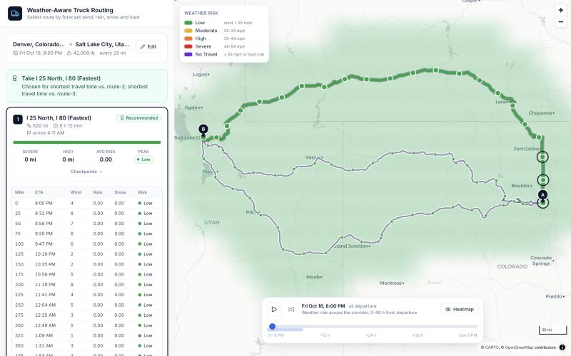

# Weather-Aware Truck Routing

Plan the safest truck route between two places by sampling the forecast along
every route option and scoring wind, rain and snow against the load.

**Stack:** React 19 + TypeScript + MapLibre (Vite) · Django 5 + DRF · Mapbox Directions & Geocoding · Open-Meteo

| | |
|---|---|
| Live app | _add Vercel URL_ |
| API | _add Render URL_ (`/api/docs/` for Swagger) |
| Walkthrough | _add Loom URL_ |



---

## What it does

1. You enter **origin, destination, departure time and load weight** (and how often to sample weather: every 10, 25 or 50 miles).
2. The API fetches **three distinct routes** from Mapbox, walks each one and drops a **checkpoint every N miles** with the truck's **ETA** at that point, interpolated from Mapbox's per-segment durations.
3. **One batched Open-Meteo request** returns hourly wind, gusts, rain, snow and temperature for every checkpoint of every route; each checkpoint reads the hour bucket that contains its ETA.
4. The **risk engine** classifies each checkpoint with the brief's thresholds and load rules.
5. Routes are **ranked** lexicographically (No-Travel miles → Severe miles → High miles → average risk → travel time) and the best travel-safe route is **recommended** with a plain-language reason.
6. The map shows all routes, risk-coloured segments and checkpoints with ETA popups, plus a **0–48 h corridor heatmap** you can scrub or play.

## Risk rules (from the brief)

| Condition | Low | Moderate | High | Severe | No Travel |
|---|---|---|---|---|---|
| Wind (mph) | < 25 | 25–34 | 35–44 | 45–54 | ≥ 55 |
| Rain (in/hr) | < 0.10 | 0.10–0.25 | 0.25–0.50 | 0.50–1.00 | > 1.00 |
| Snow (in/hr) | < 0.5 | 0.5–1.0 | 1.0–2.0 | 2.0–3.0 | > 3.0 |

Load overrides: wind ≥ 55 mph → No Travel for any load · 45–54 mph with load > 30,000 lb → No Travel · 35–44 mph with load > 40,000 lb → Severe.

A checkpoint's level is the worst of wind, rain, snow and the load override. Each checkpoint governs the miles to the next one, which is how "Severe miles" and "High miles" are accumulated. The engine lives in [`backend/apps/risk`](backend/apps/risk) and is covered by table-driven tests for every boundary.

### Assumptions I made explicit

- **No Travel is treated as worse than Severe.** The brief's preference ladder starts at Severe miles; I sort No-Travel miles first and never recommend a route that contains any. If every route does, the UI says so instead of picking one.
- **Boundaries are lower-inclusive** (25 mph is Moderate, 0.25 in/hr is High). For the top band I follow the brief literally: wind ≥ 55 is No Travel, but rain 1.00 and snow 3.0 are still Severe.
- **Rain rate = Open-Meteo `rain + showers`** so convective rain counts. Sustained wind (`wind_speed_10m`) drives the rules; gusts are shown for context only.
- **Hourly buckets.** Open-Meteo reports hourly accumulations, so a checkpoint uses the hour containing its ETA (no interpolation between hours).
- **"Three routes" is best effort.** Mapbox returns at most two alternatives and often fewer on long trips, so I top up with toll-free and motorway-free variants and drop near-duplicates by corridor overlap. If fewer than three distinct routes exist the response says so.

## Architecture

```
┌────────────────────┐      POST /api/trips/        ┌──────────────────────────┐
│  React + MapLibre  │ ───────────────────────────▶ │  Django REST API          │
│  (Vercel)          │ ◀─────────────────────────── │  (Render, Docker)         │
│                    │   plan JSON (routes,         │                          │
│  • trip form       │   checkpoints, risk, rank)   │  apps/geo     Mapbox      │
│  • route cards     │                              │  apps/weather Open-Meteo  │
│  • map + heatmap   │  GET /api/trips/{id}/heatmap │  apps/risk    pure rules  │
│  • slider          │ ◀─────────────────────────── │  apps/trips   orchestration│
└────────────────────┘                              └───────┬──────────┬───────┘
                                                            │          │
                                                   Mapbox API      Open-Meteo
                                                 (token stays      (no key)
                                                  server-side)
```

**Backend** (`backend/`) is organised by domain with a thin service layer:

| Package | Responsibility |
|---|---|
| `apps/risk` | Thresholds as data, `assess()` for one weather sample + load, route summaries and lexicographic ranking. No Django imports. |
| `apps/geo` | Provider `Protocol`s + Mapbox adapter, checkpoint sampling along annotated geometry, 3-route guarantee with overlap de-duplication, RDP geometry simplification, cached geocoding. |
| `apps/weather` | Open-Meteo client (multi-location batches fetched concurrently, retry on timeout), hourly series with ETA bucket lookup, per-point caching. |
| `apps/trips` | Request validation, the `TripPlanner` use-case, persisted `TripPlan` model (shareable URLs), corridor heatmap builder, API views, shared error envelope. |

**Frontend** (`frontend/src/`) mirrors that by feature: `trip-form`, `routes`, `map`, `heatmap`, `health`, with a small `lib/` (typed API client, risk palette, formatting, polyline splitting) and `components/ui` primitives.

### Decisions and trade-offs

| Decision | Why |
|---|---|
| Mapbox Directions over OpenRouteService | ORS's public API caps alternative routes at 100 km; truck trips are hundreds of miles. |
| Open-Meteo for weather | Free, keyless, hourly, supports mph/inch units and many coordinates per call. |
| MapLibre + CARTO basemap | No token in the browser at all; the Mapbox token never leaves the server. |
| Heatmap as blurred cells coloured by level (not a density `heatmap` layer) | Density heatmaps get "hotter" where points are denser and blur a single Severe cell into Moderate. Level-coloured cells are honest and the slider only changes an expression index, so scrubbing is GPU-cheap. |
| Geometry simplified server-side (~30 m tolerance) | ~10× fewer vertices on the wire (a 520-mile trip is ~90 KB) with no visible change. |
| Plans are persisted | Shareable `?plan=<id>` links for evaluators; the heatmap is computed once and stored on the plan. |
| LocMem cache | Keeps repeated planning instant and well inside free-tier limits on a single instance; swap for Redis via `CACHES` if scaled out. |

## API

| Method & path | Purpose |
|---|---|
| `GET /api/health/` | Liveness + provider status (used by the UI's warm-up banner) |
| `GET /api/geocode/?q=denver` | Autocomplete places (proxied Mapbox Geocoding v6) |
| `POST /api/trips/` | Plan a trip → `201` with the full plan |
| `GET /api/trips/{id}/` | Fetch a stored plan |
| `GET /api/trips/{id}/heatmap/` | 0–48 h corridor risk grid for that plan |
| `GET /api/docs/` | Swagger UI (`/api/schema/` for OpenAPI JSON) |

```bash
curl -X POST http://localhost:8000/api/trips/ -H 'Content-Type: application/json' -d '{
  "origin": {"query": "Denver, CO"},
  "destination": {"query": "Salt Lake City, UT"},
  "departure_time": "2026-10-20T14:00:00Z",
  "load_weight_lb": 42000,
  "checkpoint_interval_miles": 25
}'
```

Errors share one envelope: `{"error": {"code": "routing_failed", "message": "...", "details": {...}}}`.

## Running locally

Prerequisites: Python 3.12+, Node 20+, a Mapbox token (free tier).

```bash
# API
cd backend
python3 -m venv .venv && source .venv/bin/activate
pip install -r requirements-dev.txt
cp .env.example .env            # put your MAPBOX_ACCESS_TOKEN in here
python manage.py migrate
python manage.py runserver      # http://localhost:8000/api/docs/

# Web (new terminal)
cd frontend
npm ci
npm run dev                     # http://localhost:5173 (proxies /api to :8000)
```

Or with Docker: `docker compose up --build`.

## Quality gates

```bash
cd backend  && ruff check . && ruff format --check . && mypy . && pytest --cov
cd frontend && npm run check    # oxlint + tsc + vitest + prettier
```

112 backend tests cover every threshold boundary, the load rules, ranking tie-breaks, checkpoint interpolation, route de-duplication, provider parsing (mocked HTTP), the planner end-to-end with fakes, and the API contract. Frontend tests cover the form validation, request mapping, GeoJSON builders, geometry splitting and formatting. CI runs all of it plus a Docker build on every push.

## Deployment

See [docs/DEPLOYMENT.md](docs/DEPLOYMENT.md) for click-by-click steps (Vercel for the web app, Render for the API, Neon for Postgres). `render.yaml` and `frontend/vercel.json` are included.

## Project layout

```
backend/      Django API (apps/geo, apps/weather, apps/risk, apps/trips, tests/)
frontend/     React app (src/features/*, src/lib, src/components/ui)
docs/         Deployment guide
.github/      CI workflow
```

## What I'd do next

- Truck-specific routing (height/weight restrictions) via a truck profile provider.
- Time-shifted re-planning ("leave 3 h later?") using the same forecast data.
- Redis cache and request coalescing when running more than one API instance.
- Playwright smoke test of the full flow against mocked providers.

## License

MIT
